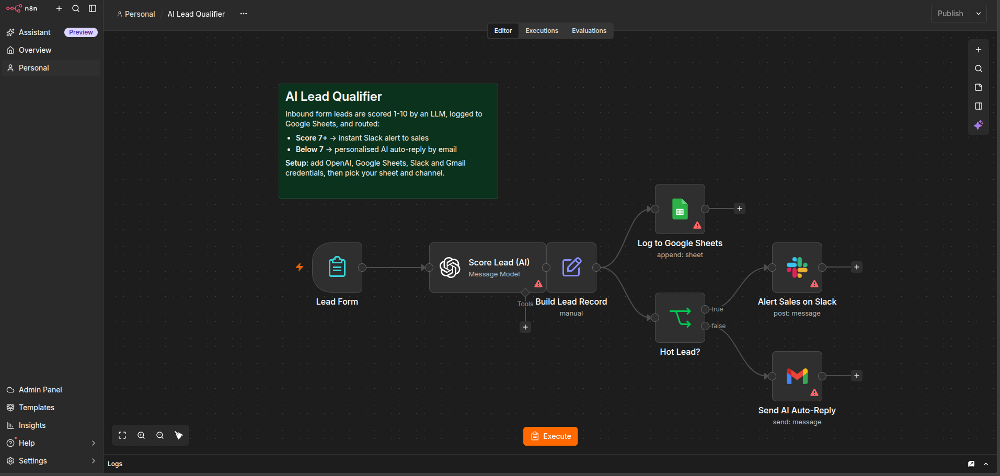
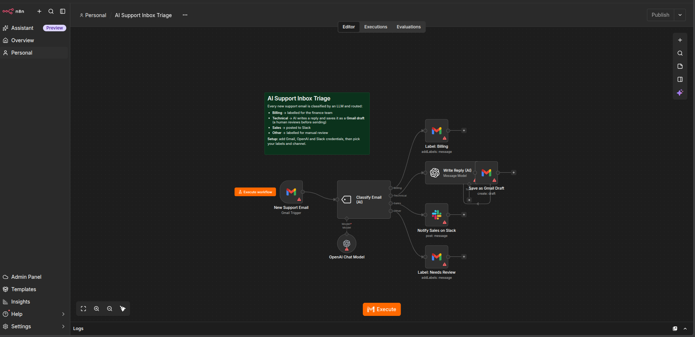
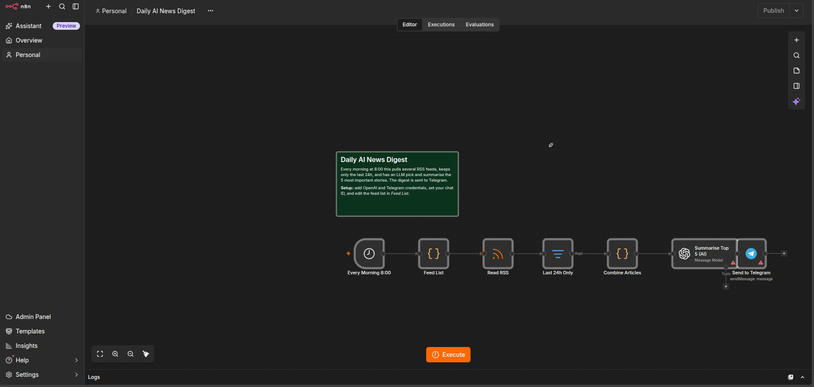

# n8n AI Automation Portfolio

Personal projects: AI-powered business automations built with [n8n](https://n8n.io).
Every workflow here is importable. Download the JSON, then in n8n go to **Workflows → Import from File**, add your credentials and run it.

| # | Project | Trigger | What the AI does | Integrations |
|---|---------|---------|------------------|--------------|
| 1 | [AI Lead Qualifier](#1-ai-lead-qualifier) | Web form | Scores leads, writes personalised replies | Google Sheets, Slack, Gmail |
| 2 | [AI Support Inbox Triage](#2-ai-support-inbox-triage) | New email | Classifies tickets, drafts replies | Gmail, Slack |
| 3 | [Daily AI News Digest](#3-daily-ai-news-digest) | Schedule (8:00 daily) | Curates and summarises news | RSS, Telegram |

---

## 1. AI Lead Qualifier

**Problem:** Sales teams waste time reading every inbound lead, and hot leads wait hours for a reply.

**How it works:**
1. A prospect fills in the n8n **form** (name, email, company, budget, message).
2. **OpenAI (gpt-4o-mini)** scores the lead 1–10 and returns structured JSON: score, category, summary and a suggested reply.
3. Every lead is logged to **Google Sheets**.
4. **Score 7+** sends an instant **Slack** alert to sales. **Below 7** sends the AI-written reply to the lead via **Gmail**.

**Design decisions:**
- JSON output mode plus a low temperature (0.2), so the score is machine-readable and consistent.
- Logging and routing run in parallel, so no lead is lost even if Slack or Gmail fails.

[Workflow JSON](workflows/01-ai-lead-qualifier.json)

---

## 2. AI Support Inbox Triage

**Problem:** A shared support inbox mixes billing, bugs, sales and spam, so someone has to sort it all by hand.

**How it works:**
1. The **Gmail trigger** picks up each new email.
2. n8n's **Text Classifier** (LangChain node with an OpenAI chat model) sorts it into Billing / Technical / Sales / Other.
3. Each category takes its own path:
   - **Billing** gets labelled for the finance team.
   - **Technical**: the AI writes a reply and saves it as a **Gmail draft** in the same thread.
   - **Sales** is posted to **Slack**.
   - **Other** is labelled for manual review.

**Design decisions:**
- **Human in the loop:** AI replies are saved as drafts, never sent automatically, so an agent reviews each one before it goes out.
- The prompt tells the AI never to promise refunds or timelines.
- Temperature 0 for classification, so the same email always lands in the same bucket.

[Workflow JSON](workflows/02-ai-support-inbox-triage.json)

---

## 3. Daily AI News Digest

**Problem:** Keeping up with AI news means checking several sites every day.

**How it works:**
1. A **schedule trigger** fires every morning at 8:00.
2. A **Code node** lists the RSS feeds, and **RSS Read** fetches all of them.
3. A **Filter** keeps only stories from the last 24 hours.
4. A **Code node** merges them into one prompt, capped at 40 stories to control token cost.
5. **OpenAI** picks the 5 most important stories and summarises each one in 2 sentences.
6. The digest is sent to **Telegram**.

[Workflow JSON](workflows/03-daily-ai-news-digest.json)

---

## Skills demonstrated

- **Triggers:** forms, email polling, cron schedules
- **AI:** OpenAI node, LangChain Text Classifier with a sub-node model, prompt design, structured JSON output
- **Logic:** IF branching, multi-output routing, filters
- **Data:** Set node mapping, n8n expressions, JavaScript Code nodes, cross-node references (`$('Node').item.json`)
- **Integrations:** Gmail, Google Sheets, Slack, Telegram, RSS
- **Production thinking:** human-in-the-loop review, cost caps, parallel logging, prompt guardrails
